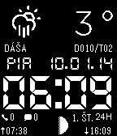

<!-- Generated by scripts/update_app_directory.py: do not edit by hand -->
[← All Pebble Developers](../developers.md)

# mc1100

*1 watchface · Last updated 2026-10-12 · [About these lists](../about-app-lists.md)*

Links: [Pebble App Store](https://apps.repebble.com/apps/dev/mc1100_5299fcee129af7ea5f0000a1) · [GitHub (mc1100)](https://github.com/mc1100)

<h2 class="app-name" id="app-52cf86f58fdab5f51e000040"><a href="https://apps.repebble.com/52cf86f58fdab5f51e000040">91 Weather Moon Names SK</a> v2.0.1</h2>
<a class="app-source" href="https://github.com/mc1100/ninety_weather_moon_names_sk/tree/sdk_2.0" title="Source code" data-search-exclude>View source</a>

Watchface

Released 2014-01-10 Updated 2014-01-20

Runs on: Time 2, Pebble 2 Duo, Pebble 2, Time, Classic

A digital watchface which displays current weather, temperature, moon phase, sunrise, sunset and Slovak nameday.

