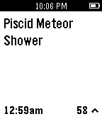
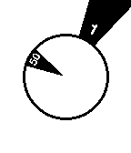
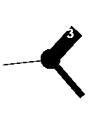

<!-- Generated by scripts/update_app_directory.py: do not edit by hand -->
[← All Pebble Developers](../developers.md)

# mcongrove

*6 watchfaces and 2 apps · Last updated 2026-10-11 · [About these lists](../about-app-lists.md)*

Links: [Pebble App Store](https://apps.repebble.com/apps/dev/mcongrove_52affc34e2187058f9000011) · [Rebble App Store](https://apps.rebble.io/en_US/developer/52affc34e2187058f9000011/1) · [GitHub (mcongrove)](https://github.com/mcongrove) · [Website (wearewearable.com)](http://www.WeAreWearable.com)

<button type="button" data-filter="all" aria-pressed="true">All 8</button><button type="button" data-filter="watchface" aria-pressed="false">Watchfaces 6</button><button type="button" data-filter="watchapp" aria-pressed="false">Apps 2</button>

<label class="dev-sort">Sort by <select><option value="updated">Recently updated</option><option value="released">Newest release</option><option value="title">A–Z</option></select></label>

<h2 class="app-name" id="app-54320b0b106a8c3b05000064"><a href="https://apps.repebble.com/54320b0b106a8c3b05000064">Forekast</a> v1.0</h2>
<a class="app-source" href="https://github.com/mcongrove/ForekastPebble" title="Source code" data-search-exclude>View source</a>

App

Released 2014-10-06 Updated 2014-10-06

Runs on: Time 2, Pebble 2 Duo, Pebble 2, Time, Classic

Get today&#x27;s Forekast events right on your wrist. Forekast is a calendar of amazing events happening worldwide, posted and voted on by an international community. Music festivals, rocket launches…

<h2 class="app-name" id="app-53fc163a026283911c0000db"><a href="https://apps.rebble.io/en_US/application/53fc163a026283911c0000db">BiteBook</a> v1.1</h2>
<a class="app-source" href="http://github.com/mcongrove/BiteBook" title="Source code" data-search-exclude>View source</a>

App

No licence Released 2014-08-26 Updated 2014-09-05 Rebble App Store

Runs on: Time 2, Pebble 2 Duo, Pebble 2, Time, Classic

BiteBook is a simple fish logging application. When you&#x27;re out on a boat, getting your phone out of it&#x27;s waterproof case to open a fish logging app with a million options is the worst. Who wants…

<h2 class="app-name" id="app-52affd2e4002497d9e00000a"><a href="https://apps.repebble.com/52affd2e4002497d9e00000a">Mask</a> v2.1</h2>
<a class="app-source" href="https://github.com/mcongrove/PebbleMask" title="Source code" data-search-exclude>View source</a>

Watchface

Released 2013-12-17 Updated 2014-01-19

Runs on: Time 2, Pebble 2 Duo, Pebble 2, Time, Classic

A Pebble watch face based on the Mask watch by Filip Slovacek. Each triangle turns to reveal the current time; hour on the outer, minute on the inner. The time is updated in 5-minute increments…

<h2 class="app-name" id="app-52cdd3b70b54db5fb900001b"><a href="https://apps.repebble.com/52cdd3b70b54db5fb900001b">Flying Blind</a> v1.1</h2>
<a class="app-source" href="https://github.com/mcongrove/PebbleFlyingBlind" title="Source code" data-search-exclude>View source</a>

Watchface

Released 2014-01-08 Updated 2014-01-19

Runs on: Time 2, Pebble 2 Duo, Pebble 2, Time, Classic

A Pebble watch face that vibrates the time. Optionally vibrates every half or quarter-hour. Shake your wrist to briefly see the time. Colors can be inverted and vibration intervals can be set by…

<h2 class="app-name" id="app-52b010d7e2187074f100001a"><a href="https://apps.repebble.com/52b010d7e2187074f100001a">Extra Normal</a> v2.1</h2>
<a class="app-source" href="https://github.com/mcongrove/PebbleExtraNormal" title="Source code" data-search-exclude>View source</a>

Watchface

Released 2013-12-17 Updated 2014-01-19

Runs on: Time 2, Pebble 2 Duo, Pebble 2, Time, Classic

A Pebble watch face based on the Extra Normal watch face. Hour hands turn to reveal the current time as it passes overhead. Colors can be inverted by accessing the settings in the Pebble application.

<h2 class="app-name" id="app-52cdd4a72797163d1a000001"><a href="https://apps.repebble.com/52cdd4a72797163d1a000001">Daylight</a> v1.1</h2>
<a class="app-source" href="https://github.com/mcongrove/PebbleDaylight" title="Source code" data-search-exclude>View source</a>

Watchface

Released 2014-01-08 Updated 2014-01-19

Runs on: Time 2, Pebble 2 Duo, Pebble 2, Time, Classic

A Pebble watch face that shows the daylight as it streaks across the globe. Land masses can be shown or hidden by accessing the settings in the Pebble application.

<h2 class="app-name" id="app-52b3ec30f60b55482b00000c"><a href="https://apps.repebble.com/52b3ec30f60b55482b00000c">Date Countdown</a> v2.1</h2>
<a class="app-source" href="https://github.com/mcongrove/PebbleDateCountdown" title="Source code" data-search-exclude>View source</a>

Watchface

Released 2013-12-20 Updated 2014-01-19

Runs on: Time 2, Pebble 2 Duo, Pebble 2, Time, Classic

A Pebble watch app for counting down the number of days until an event. Colors can be inverted and the event date, time, and label can be set by accessing the settings in the Pebble application.

<h2 class="app-name" id="app-52cdd45efc5bf835cb00001e"><a href="https://apps.repebble.com/52cdd45efc5bf835cb00001e">Big Blocks</a> v1.1</h2>
<a class="app-source" href="https://github.com/mcongrove/PebbleBigBlocks" title="Source code" data-search-exclude>View source</a>

Watchface

Released 2014-01-08 Updated 2014-01-19

Runs on: Time 2, Pebble 2 Duo, Pebble 2, Time, Classic

A Pebble face where large blocks build up around the edge of the watch as the hours tick along. Colors can be inverted, and display of the full time, hour, or minute can be set by accessing the…

