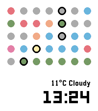

<!-- Generated by scripts/update_app_directory.py: do not edit by hand -->
[← All Pebble Developers](../developers.md)

# mdlt7z

*1 watchface · Last updated 2026-10-11 · [About these lists](../about-app-lists.md)*

Links: [Pebble App Store](https://apps.repebble.com/apps/dev/mdlt7z_dd1c5ad7d92a5dd3acb1e367) · [GitHub (mdlt7z)](https://github.com/mdlt7z) · [Website (mdlt7z.com)](https://mdlt7z.com)

<h2 class="app-name" id="app-e7546ae4120f414d9c7014b0"><a href="https://apps.repebble.com/e7546ae4120f414d9c7014b0">7dots</a> v1.0</h2>
<a class="app-source" href="https://github.com/mdlt7z/7dots" title="Source code" data-search-exclude>View source</a>

Watchface

Released 2026-04-18 Updated 2026-04-18

Runs on: Round 2, Time 2, Time Round, Time

Minimalist information display using 7 dots ;) ## Dot Features - 📅 Day of the week - 👟 Step goal progress - ☁️ Weather forecast - ☀️ Sunrise/Sunset - 🔋 Battery The colors give you a &quot;feel&quot; for…

