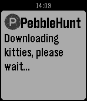

<!-- Generated by scripts/update_app_directory.py: do not edit by hand -->
[← All Pebble Developers](../developers.md)

# mdottavio

*1 app · Last updated 2026-10-11 · [About these lists](../about-app-lists.md)*

Links: [Pebble App Store](https://apps.repebble.com/apps/dev/mdottavio_56353e969ac02bbf3700000f) · [GitHub (mdottavio)](https://github.com/mdottavio)

<h2 class="app-name" id="app-5648ba2982267d5caa00006c"><a href="https://apps.repebble.com/5648ba2982267d5caa00006c">PHuntFeed</a> v1.0</h2>
<a class="app-source" href="https://github.com/mdottavio/pebblehunt" title="Source code" data-search-exclude>View source</a>

App

Released 2015-11-15 Updated 2015-11-15

Runs on: Time 2, Pebble 2 Duo, Pebble 2, Time, Classic

Get the latests 10 posts from ProductHunt.

