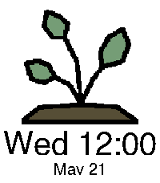

<!-- Generated by scripts/update_app_directory.py: do not edit by hand -->
[← All Pebble Developers](../developers.md)

# Meep Apps

*1 watchface · Last updated 2026-10-11 · [About these lists](../about-app-lists.md)*

Links: [Rebble App Store](https://apps.rebble.io/en_US/developer/69483fa7eea8e40009e75373/1) · [GitHub (only-meeps)](https://github.com/only-meeps)

<h2 class="app-name" id="app-694851d4ce101c0009b63345"><a href="https://apps.rebble.io/en_US/application/694851d4ce101c0009b63345">Seasons clock</a> v1.5</h2>
<a class="app-source" href="https://github.com/only-meeps/Seasons-Clock-Pebble" title="Source code" data-search-exclude>View source</a>

Watchface · <a href="https://forum.rebble.io/t/333" title="Discuss this app on the Rebble forum" data-search-exclude>Forum thread</a>

Released 2025-12-21 Updated 2025-12-22 Rebble App Store

Runs on: Round 2, Time 2, Pebble 2 Duo, Pebble 2, Time Round, Time, Classic

A simple clock to show the different seasons! Uses a simple Meeus algorithm that runs once a year to get the times of the different seasons! Credit to @Yadis# on discord for coming up with the idea!

