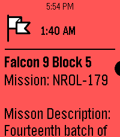

<!-- Generated by scripts/update_app_directory.py: do not edit by hand -->
[← All Pebble Developers](../developers.md)

# Meep apps

*1 app · Last updated 2026-10-11 · [About these lists](../about-app-lists.md)*

Links: [Pebble App Store](https://apps.repebble.com/apps/dev/meep-apps_afb52ceff8e7b6067c428fea) · [GitHub (only-meeps)](https://github.com/only-meeps)

<h2 class="app-name" id="app-bc759f096635405aabe7c52e"><a href="https://apps.repebble.com/bc759f096635405aabe7c52e">Liftoff 2</a> v9.7</h2>
<a class="app-source" href="https://github.com/only-meeps/Liftoff-2-Pebble" title="Source code" data-search-exclude>View source</a>

App · <a href="https://forum.rebble.io/t/1068" title="Discuss this app on the Rebble forum" data-search-exclude>Forum thread</a>

Released 2026-06-18 Updated 2026-08-09

Runs on: Round 2, Time 2, Pebble 2 Duo, Pebble 2, Time Round, Time, Classic

Inspired by the watch timeline app liftoff, this app shows timeline pins about upcoming launches with a small description provided thespacedevs.com. Unfortunately, due to the current pebble app…

