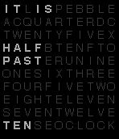

<!-- Generated by scripts/update_app_directory.py: do not edit by hand -->
[← All Pebble Developers](../developers.md)

# melekzek

*2 watchfaces · Last updated 2026-10-12 · [About these lists](../about-app-lists.md)*

Links: [Rebble App Store](https://apps.rebble.io/en_US/developer/57e1e80016a229658300013f/1) · [Pebble App Store](https://apps.repebble.com/apps/dev/melekzek_57e1e80016a229658300013f) · [GitHub (melekzek)](https://github.com/melekzek)

<button type="button" data-filter="all" aria-pressed="true">All 2</button><button type="button" data-filter="watchface" aria-pressed="false">Watchfaces 2</button><button type="button" data-filter="watchapp" aria-pressed="false" disabled>Apps 0</button>

<label class="dev-sort">Sort by <select><option value="updated">Recently updated</option><option value="released">Newest release</option><option value="title">A–Z</option></select></label>

<h2 class="app-name" id="app-596f09ff0dfc323e110000d3"><a href="https://apps.rebble.io/en_US/application/596f09ff0dfc323e110000d3">vague text with hr</a> v1.1</h2>
<a class="app-source" href="https://github.com/melekzek/pebble-text-with-hr" title="Source code" data-search-exclude>View source</a>

Watchface

Released 2017-07-19 Updated 2017-07-22 Rebble App Store

Runs on: Time 2, Pebble 2 Duo, Pebble 2, Time, Classic

Vague text-based watchface with hr support on pebble2. Double tap to temporarily switch to digital display for accurate time and hr.

<h2 class="app-name" id="app-582cf21a8c7fff098b000144"><a href="https://apps.repebble.com/582cf21a8c7fff098b000144">Text based on QLOCKTWO</a> v0.2</h2>
<a class="app-source" href="http://github.com/melekzek/pebble-QLOCKTWO" title="Source code" data-search-exclude>View source</a>

Watchface

No licence Released 2016-11-16 Updated 2017-05-07

Runs on: Time 2, Pebble 2 Duo, Pebble 2, Time, Classic

Text watchface based on qlocktwo watch. http://qlocktwo.com/ TODO: - Add minute dots as an option. - Add some predefined default colors. - Hide and compress unused lines if there is a notification…

