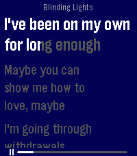

<!-- Generated by scripts/update_app_directory.py: do not edit by hand -->
[← All Pebble Developers](../developers.md)

# meowarex

*1 app · Last updated 2026-10-12 · [About these lists](../about-app-lists.md)*

Links: [Pebble App Store](https://apps.repebble.com/apps/dev/meowarex_a367b02b52abb6fdca6cbe15) · [GitHub (meowarex)](https://github.com/meowarex) · [Website (radiant-lyrics.org)](https://radiant-lyrics.org)

<h2 class="app-name" id="app-02b779dcf9084fecb0375df1"><a href="https://apps.repebble.com/02b779dcf9084fecb0375df1">Radiant Lyrics</a> v1.3.0</h2>
<a class="app-source" href="https://github.com/meowarex/rl-pebble" title="Source code" data-search-exclude>View source</a>

App

Released 2026-09-17 Updated 2026-09-17

Runs on: Round 2, Time 2, Pebble 2 Duo, Pebble 2, Time Round, Time

Relays Radiant Lyrics to your Pebble Time 2!

