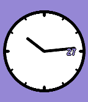
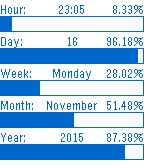
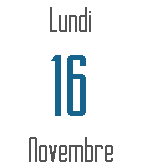
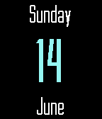
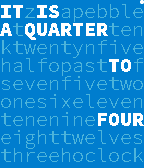
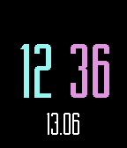

<!-- Generated by scripts/update_app_directory.py: do not edit by hand -->
[← All Pebble Developers](../developers.md)

# mephissto

*9 watchfaces and 2 apps · Last updated 2026-10-11 · [About these lists](../about-app-lists.md)*

Links: [Pebble App Store](https://apps.repebble.com/apps/dev/mephissto_5362a57dc2a5e4f05c000021) · [GitHub (mephissto)](https://github.com/mephissto)

<button type="button" data-filter="all" aria-pressed="true">All 11</button><button type="button" data-filter="watchface" aria-pressed="false">Watchfaces 9</button><button type="button" data-filter="watchapp" aria-pressed="false">Apps 2</button>

<label class="dev-sort">Sort by <select><option value="updated">Recently updated</option><option value="released">Newest release</option><option value="title">A–Z</option></select></label>

<h2 class="app-name" id="app-55835eac2f3e32222b00002c"><a href="https://apps.repebble.com/55835eac2f3e32222b00002c">KS moded</a> v1.1</h2>
<a class="app-source" href="https://github.com/mephissto/ks-clock-face/" title="Source code" data-search-exclude>View source</a>

Watchface

Released 2015-06-19 Updated 2016-01-27

Runs on: Time 2, Time

Simple watchface based on KS Original

<h2 class="app-name" id="app-569e9c94099696ec1500003f"><a href="https://apps.repebble.com/569e9c94099696ec1500003f">MetroWatch Red</a> v1.0</h2>
<a class="app-source" href="https://github.com/mephissto/MetroWatch/tree/red" title="Source code" data-search-exclude>View source</a>

Watchface

Released 2016-01-19 Updated 2016-01-19

Runs on: Time 2, Time

Red version of MetroWatch color

<h2 class="app-name" id="app-569e9da6099696e83d00005b"><a href="https://apps.repebble.com/569e9da6099696e83d00005b">MetroWatch Purple</a> v1.0</h2>
<a class="app-source" href="https://github.com/mephissto/MetroWatch/tree/purple" title="Source code" data-search-exclude>View source</a>

Watchface

Released 2016-01-19 Updated 2016-01-19

Runs on: Time 2, Time

Purple version of metrowatch color

<h2 class="app-name" id="app-569e9ec480b0d26c48000035"><a href="https://apps.repebble.com/569e9ec480b0d26c48000035">MetroWatch Green</a> v1.0</h2>
<a class="app-source" href="https://github.com/mephissto/MetroWatch/tree/green" title="Source code" data-search-exclude>View source</a>

Watchface

Released 2016-01-19 Updated 2016-01-19

Runs on: Time 2, Time

Green version of MetroWatch Color watchface.

<h2 class="app-name" id="app-564a540f5a5002181e000003"><a href="https://apps.repebble.com/564a540f5a5002181e000003">Progressor Color</a> v1.0</h2>
<a class="app-source" href="https://github.com/mephissto/Progressor" title="Source code" data-search-exclude>View source</a>

Watchface

Released 2015-11-16 Updated 2015-11-16

Runs on: Time 2, Time

First release

<h2 class="app-name" id="app-564a3d7a406ba6596c00007e"><a href="https://apps.repebble.com/564a3d7a406ba6596c00007e">2Day App Light</a> v1.0</h2>
<a class="app-source" href="https://github.com/mephissto/2day-app-light" title="Source code" data-search-exclude>View source</a>

App

Released 2015-11-16 Updated 2015-11-16

Runs on: Time 2, Pebble 2 Duo, Pebble 2, Time, Classic

2Day Appl with light color

<h2 class="app-name" id="app-557c61814923dd2fc0000051"><a href="https://apps.repebble.com/557c61814923dd2fc0000051">2Day App</a> v1.1</h2>
<a class="app-source" href="https://github.com/mephissto/2day-app" title="Source code" data-search-exclude>View source</a>

App

Released 2015-06-13 Updated 2015-11-16

Runs on: Time 2, Pebble 2 Duo, Pebble 2, Time, Classic

Simple app that display the current day of the weak, day of the month and the month. Sometimes I use a watchface that don&#x27;t have the day of the week or the month, and when you need this…

<h2 class="app-name" id="app-55789a4753e13cba20000061"><a href="https://apps.repebble.com/55789a4753e13cba20000061">Thin moded</a> v1.1</h2>
<a class="app-source" href="https://github.com/mephissto/thin" title="Source code" data-search-exclude>View source</a>

Watchface

Released 2015-06-10 Updated 2015-06-20

Runs on: Time 2, Pebble 2 Duo, Pebble 2, Time, Classic

Based on the Thin watchface made by Chris Lewis. !! New Theme !! - Green - Red - Purple

<h2 class="app-name" id="app-55809a58fc670b738a000062"><a href="https://apps.repebble.com/55809a58fc670b738a000062">MetroWatch Color</a> v1.0</h2>
<a class="app-source" href="https://github.com/mephissto/MetroWatch" title="Source code" data-search-exclude>View source</a>

Watchface

Released 2015-06-16 Updated 2015-06-16

Runs on: Time 2, Time

Based on Metro Watch by Marc Ferrándiz Borràs

<h2 class="app-name" id="app-5580297bda86937b5c00001c"><a href="https://apps.repebble.com/5580297bda86937b5c00001c">ChronoCode Color</a> v1.1</h2>
<a class="app-source" href="https://github.com/mephissto/pebble-chronocode" title="Source code" data-search-exclude>View source</a>

Watchface

Released 2015-06-16 Updated 2015-06-16

Runs on: Time 2, Time

Based on ChronoCode by rexmac. 3 themes : blue, green &amp; red. And their inverted color.

<h2 class="app-name" id="app-557c085d4923dd0b17000009"><a href="https://apps.repebble.com/557c085d4923dd0b17000009">Simple Digital</a> v1.1</h2>
<a class="app-source" href="https://github.com/mephissto/simple-digital" title="Source code" data-search-exclude>View source</a>

Watchface

Released 2015-06-13 Updated 2015-06-15

Runs on: Time 2, Pebble 2 Duo, Pebble 2, Time, Classic

Simple digital watchfaces with day of the month and month. Inspired by M360 Digital Watchface. Upcoming features : * Choose date format : DD.MM or MM.DD * Change colors

