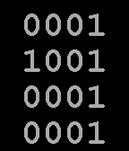

<!-- Generated by scripts/update_app_directory.py: do not edit by hand -->
[← All Pebble Developers](../developers.md)

# Merddyn

*3 watchfaces · Last updated 2026-10-11 · [About these lists](../about-app-lists.md)*

Links: [Pebble App Store](https://apps.repebble.com/apps/dev/merddyn_53fb5515994475d7f3000054) · [GitHub (pgbunce)](https://github.com/pgbunce)

<button type="button" data-filter="all" aria-pressed="true">All 3</button><button type="button" data-filter="watchface" aria-pressed="false">Watchfaces 3</button><button type="button" data-filter="watchapp" aria-pressed="false" disabled>Apps 0</button>

<label class="dev-sort">Sort by <select><option value="updated">Recently updated</option><option value="released">Newest release</option><option value="title">A–Z</option></select></label>

<h2 class="app-name" id="app-550cad5a2fbbaacde3000060"><a href="https://apps.repebble.com/550cad5a2fbbaacde3000060">Binary Time - Waveform</a> v1.4</h2>
<a class="app-source" href="https://github.com/pgbunce/wf-binary-time-waveform" title="Source code" data-search-exclude>View source</a>

Watchface

Released 2015-03-20 Updated 2015-10-31

Runs on: Time 2, Pebble 2 Duo, Pebble 2, Time, Classic

Shows the time (12 or 24 hour) in binary format, 4 bits per time digit, as a waveform :)

<h2 class="app-name" id="app-5519a59c0f4ab7222e000003"><a href="https://apps.repebble.com/5519a59c0f4ab7222e000003">Binary Time - Grid</a> v1.2</h2>
<a class="app-source" href="https://github.com/pgbunce/binaryTimeGrid" title="Source code" data-search-exclude>View source</a>

Watchface

Released 2015-03-30 Updated 2015-10-31

Runs on: Time 2, Pebble 2 Duo, Pebble 2, Time, Classic

Shows the time in binary, four bits per time digit, in a grid layout. Time is shown in either 12- or 24-hour mode, as set in the watch settings. There is an &quot;on-shake&quot; animation to show the time…

<h2 class="app-name" id="app-550c4830d4c6b4b94e000007"><a href="https://apps.repebble.com/550c4830d4c6b4b94e000007">Binary Time</a> v1.3</h2>
<a class="app-source" href="https://github.com/pgbunce/wf-binary-time" title="Source code" data-search-exclude>View source</a>

Watchface

Released 2015-03-20 Updated 2015-10-31

Runs on: Time 2, Pebble 2 Duo, Pebble 2, Time, Classic

Shows the time in binary, four bits per time digit. Time is shown in either 12- or 24-hour mode, as set in the watch settings.

