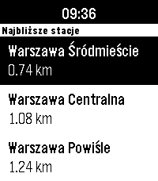

<!-- Generated by scripts/update_app_directory.py: do not edit by hand -->
[← All Pebble Developers](../developers.md)

# merito

*1 app · Last updated 2026-10-12 · [About these lists](../about-app-lists.md)*

Links: [Pebble App Store](https://apps.repebble.com/apps/dev/merito_6883657b0c0ce60008a5293f) · [GitHub (merito)](https://github.com/merito)

<h2 class="app-name" id="app-68a759a7652aec0009f26c41"><a href="https://apps.repebble.com/68a759a7652aec0009f26c41">Rozkład jazdy pociągów Polish Trains</a> v1.7.2</h2>
<a class="app-source" href="https://github.com/merito/rozklad_jazdy_pociagow" title="Source code" data-search-exclude>View source</a>

App · <a href="https://forum.rebble.io/t/837" title="Discuss this app on the Rebble forum" data-search-exclude>Forum thread</a>

Released 2025-08-21 Updated 2026-09-10

Runs on: Time 2, Pebble 2 Duo, Pebble 2, Time, Classic

Never miss your train again! The app shows the closest stations and departures with delays, platform and track numbers. It primarily uses the custom backend in `rozklad_backend/` directory, which…

