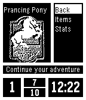

<!-- Generated by scripts/update_app_directory.py: do not edit by hand -->
[← All Pebble Developers](../developers.md)

# metroidmen

*1 app · Last updated 2026-10-12 · [About these lists](../about-app-lists.md)*

Links: [Pebble App Store](https://apps.repebble.com/apps/dev/metroidmen_529f67f51a663894e5000071) · [GitHub (Torivon)](https://github.com/Torivon)

<h2 class="app-name" id="app-53b6d46f8847ca3dd200027c"><a href="https://apps.repebble.com/53b6d46f8847ca3dd200027c">MiniLOTR</a> v1.1</h2>
<a class="app-source" href="https://github.com/Torivon/MiniDungeon" title="Source code" data-search-exclude>View source</a>

App

MIT Released 2014-07-04 Updated 2014-07-25

Runs on: Time 2, Pebble 2 Duo, Pebble 2, Time, Classic

Traverse Middle-Earth fighting your way through random encounters with all of your favorite creatures from Tolkiens universe! Stay alive, use your magic sparingly, and prepare yourself for your…

