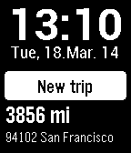
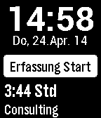

<!-- Generated by scripts/update_app_directory.py: do not edit by hand -->
[← All Pebble Developers](../developers.md)

# meyer-solutions

*2 apps · Last updated 2026-10-12 · [About these lists](../about-app-lists.md)*

Links: [Rebble App Store](https://apps.rebble.io/en_US/developer/52b200a105c0464291000030/1) · [Website (macxperience.de)](http://www.macxperience.de/Apps/Fahrtenbuch/Pebble/Pebble.html)

<button type="button" data-filter="all" aria-pressed="true">All 2</button><button type="button" data-filter="watchface" aria-pressed="false" disabled>Watchfaces 0</button><button type="button" data-filter="watchapp" aria-pressed="false">Apps 2</button>

<label class="dev-sort">Sort by <select><option value="updated">Recently updated</option><option value="released">Newest release</option><option value="title">A–Z</option></select></label>

<h2 class="app-name" id="app-5328353ce35fcc67380002a8"><a href="https://apps.rebble.io/en_US/application/5328353ce35fcc67380002a8">Mileage Log | Fahrtenbuch</a> v1.3</h2>
<a class="app-source" href="https://itunes.apple.com/us/app/fahrtenbuch/id286070473?mt=8" title="Source code" data-search-exclude>View source</a>

App

Released 2014-03-18 Updated 2014-11-05 Rebble App Store

Runs on: Time 2, Pebble 2 Duo, Pebble 2, Time, Classic

Mileage Log | Fahrtenbuch - the #1 mileage logging application in Germany, essential for anyone who needs to track mileage for tax deduction or reimbursement. Enjoy your pebble, enjoy your ride…

<h2 class="app-name" id="app-535928d3bb7fb9eac40001aa"><a href="https://apps.rebble.io/en_US/application/535928d3bb7fb9eac40001aa">Stempeluhr</a> v1.2</h2>
<a class="app-source" href="https://itunes.apple.com/de/app/stempeluhr/id331889894?mt=8" title="Source code" data-search-exclude>View source</a>

App

Released 2014-04-24 Updated 2014-09-03 Rebble App Store

Runs on: Time 2, Pebble 2 Duo, Pebble 2, Time, Classic

Zeiterfassung mit GPS Unterstützung - erkennt Ihren Kunden vor Ort automatisch wieder! Sie arbeiten für einen Kunden und sind es leid umständlich einzelne Zeiten für Kundenprojekte zu…

