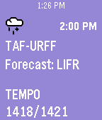
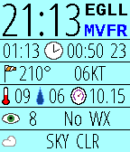
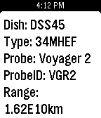

<!-- Generated by scripts/update_app_directory.py: do not edit by hand -->
[← All Pebble Developers](../developers.md)

# Michael duPont

*2 watchfaces and 2 apps · Last updated 2026-10-11 · [About these lists](../about-app-lists.md)*

Links: [Pebble App Store](https://apps.repebble.com/apps/dev/michael-dupont_54b1357d1af59f571c00008d) · [GitHub (flyinactor91)](https://github.com/flyinactor91)

<button type="button" data-filter="all" aria-pressed="true">All 4</button><button type="button" data-filter="watchface" aria-pressed="false">Watchfaces 2</button><button type="button" data-filter="watchapp" aria-pressed="false">Apps 2</button>

<label class="dev-sort">Sort by <select><option value="updated">Recently updated</option><option value="released">Newest release</option><option value="title">A–Z</option></select></label>

<h2 class="app-name" id="app-55542994b5b4f648720000d9"><a href="https://apps.repebble.com/55542994b5b4f648720000d9">TAFline</a> v1.3</h2>
<a class="app-source" href="https://github.com/flyinactor91/TAFline" title="Source code" data-search-exclude>View source</a>

App

Released 2015-05-14 Updated 2019-07-24

Runs on: Round 2, Time 2, Pebble 2 Duo, Pebble 2, Time Round, Time, Classic

Going flying today? Put a TAF report on your wrist! TAFline pushes TAF report pins into your Pebble Timeline. Not only will you get the weather forecast, but we calculate the flight rules. Icons…

<h2 class="app-name" id="app-54effd7ea53e22c57700001f"><a href="https://apps.repebble.com/54effd7ea53e22c57700001f">METAR Watchface</a> v3.7</h2>
<a class="app-source" href="https://github.com/flyinactor91/METAR-Watchface" title="Source code" data-search-exclude>View source</a>

Watchface

Released 2015-02-27 Updated 2016-11-01

Runs on: Round 2, Time 2, Pebble 2 Duo, Pebble 2, Time Round, Time, Classic

At-a-glance aviation weather on your wrist made by a pilot for pilots. This open-source watchface organizes and displays the METAR report for your favorite or nearest airport. Unlike some…

<h2 class="app-name" id="app-55aedba47328a882af000011"><a href="https://apps.repebble.com/55aedba47328a882af000011">DSN Now</a> v0.5</h2>
<a class="app-source" href="https://github.com/flyinactor91/DSN-Now-Pebble" title="Source code" data-search-exclude>View source</a>

App

Released 2015-07-21 Updated 2016-06-19

Runs on: Round 2, Time 2, Pebble 2 Duo, Pebble 2, Time Round, Time, Classic

The Deep Space Network on your Pebble. Displays the dishes at various stations that are currently communicating with our deep space probes and the type of link (uplink/downlink). Cards also…

<h2 class="app-name" id="app-54f934651358a963ac0000e3"><a href="https://apps.repebble.com/54f934651358a963ac0000e3">METAR Minimal</a> v3.4</h2>
<a class="app-source" href="https://github.com/flyinactor91/METAR-Watchface" title="Source code" data-search-exclude>View source</a>

Watchface

Released 2015-03-06 Updated 2016-01-21

Runs on: Round 2, Time 2, Pebble 2 Duo, Pebble 2, Time Round, Time, Classic

Need to know the time? We got that. Need to know if your favorite airport is VFR, MVFR, IFR, or LIFR? We got that too...and that&#x27;s it! At-a-glance aviation weather on your wrist made by a pilot…

