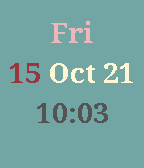

<!-- Generated by scripts/update_app_directory.py: do not edit by hand -->
[← All Pebble Developers](../developers.md)

# Michael Kang

*1 watchface and 1 app · Last updated 2026-10-11 · [About these lists](../about-app-lists.md)*

Links: [Pebble App Store](https://apps.repebble.com/apps/dev/michael-kang_54e5499d58f9c95019000023) · [GitHub (mrmichaelkang)](https://github.com/mrmichaelkang)

<button type="button" data-filter="all" aria-pressed="true">All 2</button><button type="button" data-filter="watchface" aria-pressed="false">Watchfaces 1</button><button type="button" data-filter="watchapp" aria-pressed="false">Apps 1</button>

<label class="dev-sort">Sort by <select><option value="updated">Recently updated</option><option value="released">Newest release</option><option value="title">A–Z</option></select></label>

<h2 class="app-name" id="app-5803daf79392ff68630000bf"><a href="https://apps.repebble.com/5803daf79392ff68630000bf">Simple Time</a> v1.2</h2>
<a class="app-source" href="https://github.com/mrmichaelkang/simple-time" title="Source code" data-search-exclude>View source</a>

Watchface

Released 2016-10-16 Updated 2016-11-06

Runs on: Round 2, Time 2, Pebble 2 Duo, Pebble 2, Time Round, Time, Classic

Just a simple watch face that tells the time, date and day of week.

<h2 class="app-name" id="app-57f980d41fd66b4a2e00001e"><a href="https://apps.repebble.com/57f980d41fd66b4a2e00001e">Coin Toss</a> v1.0</h2>
<a class="app-source" href="https://github.com/mrmichaelkang/coin_toss" title="Source code" data-search-exclude>View source</a>

App

Released 2016-10-08 Updated 2016-10-08

Runs on: Round 2, Time 2, Pebble 2 Duo, Pebble 2, Time Round, Time, Classic

Coin Toss simulates a coin being flip. There is a simple counter that counts how many heads or tails have landed.

