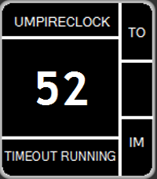
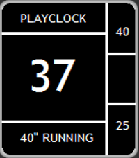
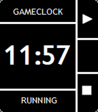

<!-- Generated by scripts/update_app_directory.py: do not edit by hand -->
[← All Pebble Developers](../developers.md)

# Michael Krenn

*3 apps · Last updated 2026-10-12 · [About these lists](../about-app-lists.md)*

Links: [Rebble App Store](https://apps.rebble.io/en_US/developer/582d964f36ac5a946d000406/1) · [GitHub (wiesel81)](https://github.com/wiesel81)

<button type="button" data-filter="all" aria-pressed="true">All 3</button><button type="button" data-filter="watchface" aria-pressed="false" disabled>Watchfaces 0</button><button type="button" data-filter="watchapp" aria-pressed="false">Apps 3</button>

<label class="dev-sort">Sort by <select><option value="updated">Recently updated</option><option value="released">Newest release</option><option value="title">A–Z</option></select></label>

<h2 class="app-name" id="app-5864c9fb0e3a494b820002c4"><a href="https://apps.rebble.io/en_US/application/5864c9fb0e3a494b820002c4">UmpireClock (American Football)</a> v1.3</h2>
<a class="app-source" href="https://github.com/wiesel81/pebble-umpireclock" title="Source code" data-search-exclude>View source</a>

App

Released 2016-12-29 Updated 2018-04-04 Rebble App Store

Runs on: Round 2, Time 2, Pebble 2 Duo, Pebble 2, Time Round, Time, Classic

Clock for American Football Umpires working as on-field timekeeper based on the NCAA Rules 2016. With this watchapp it is possible to measure the timeouts (even a 30-second timeout) and 1-minute…

<h2 class="app-name" id="app-5849c27777324bcbcc0000bb"><a href="https://apps.rebble.io/en_US/application/5849c27777324bcbcc0000bb">PlayClock (American Football)</a> v1.1</h2>
<a class="app-source" href="https://github.com/wiesel81/pebble-playclock" title="Source code" data-search-exclude>View source</a>

App

Released 2016-12-08 Updated 2017-03-07 Rebble App Store

Runs on: Round 2, Time 2, Pebble 2 Duo, Pebble 2, Time Round, Time, Classic

Playclock for American Football officials working as on-field timekeeper based on the NCAA Rules 2016. With this watchapp it is possible to operate the 40/25 on the field without taking a look at…

<h2 class="app-name" id="app-58b20b3e0dfc320dc600090e"><a href="https://apps.rebble.io/en_US/application/58b20b3e0dfc320dc600090e">GameClock (American Football)</a> v1.0</h2>
<a class="app-source" href="https://github.com/wiesel81/pebble-gameclock" title="Source code" data-search-exclude>View source</a>

App

Released 2017-02-25 Updated 2017-03-07 Rebble App Store

Runs on: Round 2, Time 2, Pebble 2 Duo, Pebble 2, Time Round, Time, Classic

Gameclock for American Football officials working as on-field timekeeper based on the NCAA Rules 2016. With this watchapp it is possible to operate the gameclock on the field without taking a look…

