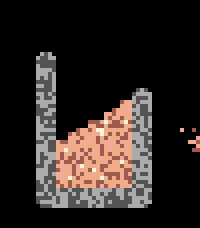
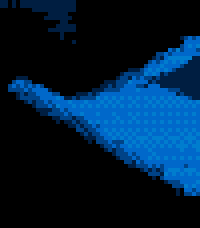

<!-- Generated by scripts/update_app_directory.py: do not edit by hand -->
[← All Pebble Developers](../developers.md)

# Michael Rex

*2 apps · Last updated 2026-10-12 · [About these lists](../about-app-lists.md)*

Links: [Pebble App Store](https://apps.repebble.com/apps/dev/michael-rex_344769cd96b2f953c9a9f56c) · [GitHub (quantumwaffles)](https://github.com/quantumwaffles)

<button type="button" data-filter="all" aria-pressed="true">All 2</button><button type="button" data-filter="watchface" aria-pressed="false" disabled>Watchfaces 0</button><button type="button" data-filter="watchapp" aria-pressed="false">Apps 2</button>

<label class="dev-sort">Sort by <select><option value="updated">Recently updated</option><option value="released">Newest release</option><option value="title">A–Z</option></select></label>

<h2 class="app-name" id="app-531be14dc8dc40c7a869464d"><a href="https://apps.repebble.com/531be14dc8dc40c7a869464d">Sand Sim</a> v0.1.0</h2>
<a class="app-source" href="https://github.com/quantumwaffles/pebble-sand-sim" title="Source code" data-search-exclude>View source</a>

App

Released 2026-06-06 Updated 2026-06-06

Runs on: Time 2

A fun little sand simulation for your wrist. Hope you enjoy! 😊 Requires Touch Support Interactions - Up → Quick select tools - Down → Quick select materials - Select → Open menu (navigate with up…

<h2 class="app-name" id="app-e20547568e884f868586e419"><a href="https://apps.repebble.com/e20547568e884f868586e419">Fluid Sim</a> v1.0.1</h2>
<a class="app-source" href="https://github.com/quantumwaffles/pebble-fluid-sim" title="Source code" data-search-exclude>View source</a>

App

Released 2026-05-31 Updated 2026-05-31

Runs on: Round 2, Time 2, Pebble 2 Duo, Pebble 2, Time Round, Time, Classic

Fluid Sim runs a real-time Navier–Stokes fluid solver on your Pebble. Dye is advected through a velocity field with diffusion and incompressible projection, producing continuous swirling…

