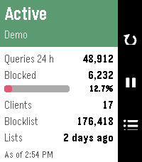
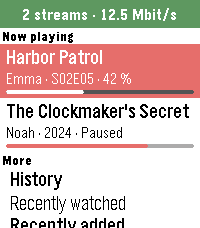

<!-- Generated by scripts/update_app_directory.py: do not edit by hand -->
[← All Pebble Developers](../developers.md)

# Michael Runge

*3 apps · Last updated 2026-10-11 · [About these lists](../about-app-lists.md)*

Links: [Pebble App Store](https://apps.repebble.com/apps/dev/michael-runge_af7723c36fa525e548676631) · [GitHub (Zeichenfolge)](https://github.com/Zeichenfolge)

<button type="button" data-filter="all" aria-pressed="true">All 3</button><button type="button" data-filter="watchface" aria-pressed="false" disabled>Watchfaces 0</button><button type="button" data-filter="watchapp" aria-pressed="false">Apps 3</button>

<label class="dev-sort">Sort by <select><option value="updated">Recently updated</option><option value="released">Newest release</option><option value="title">A–Z</option></select></label>

<h2 class="app-name" id="app-b9dca9f19dcc4ea383652449"><a href="https://apps.repebble.com/b9dca9f19dcc4ea383652449">Pi-hole</a> v1.0.0</h2>
<a class="app-source" href="https://github.com/Zeichenfolge/pihole-pebble" title="Source code" data-search-exclude>View source</a>

App

MIT Released 2026-10-09 Updated 2026-10-09

Runs on: Time 2

**English** Your Pi-hole on your wrist. Requires Pi-hole 6. STATUS • Active or paused, with countdown • Queries and blocked queries of the last 24 hours, active clients, blocklist size PAUSE • 30…

<h2 class="app-name" id="app-e1db1c9105ba4876a72a946a"><a href="https://apps.repebble.com/e1db1c9105ba4876a72a946a">Tautulli</a> v1.4.0</h2>
<a class="app-source" href="https://github.com/Zeichenfolge/tautulli-pebble" title="Source code" data-search-exclude>View source</a>

App

MIT Released 2026-10-04 Updated 2026-10-08

Runs on: Time 2

**English** Your Plex activity on your wrist, powered by your own Tautulli server. NOW PLAYING - Who is watching what, with progress, device and quality - Progress as percent, time left or end…

<h2 class="app-name" id="app-439d3664960b40d0a1911cb0"><a href="https://apps.repebble.com/439d3664960b40d0a1911cb0">Paperless</a> v1.4.0</h2>
<a class="app-source" href="https://github.com/Zeichenfolge/paperless-pebble" title="Source code" data-search-exclude>View source</a>

App

MIT Released 2026-10-02 Updated 2026-10-02

Runs on: Time 2, Pebble 2 Duo, Pebble 2, Time

Your Paperless-ngx inbox on your wrist. - See the newest documents in your inbox with correspondent and date - Look at the scan: whole page or zoomed in until the text is readable – split into…

