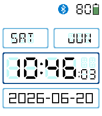

<!-- Generated by scripts/update_app_directory.py: do not edit by hand -->
[← All Pebble Developers](../developers.md)

# Michael Van Delft

*1 watchface · Last updated 2026-10-11 · [About these lists](../about-app-lists.md)*

Links: [Pebble App Store](https://apps.repebble.com/apps/dev/michael-van-delft_2dc17aa9f131bb14557374fa) · [GitHub (HybridAU)](https://github.com/HybridAU)

<h2 class="app-name" id="app-4a385da6df4a40ff9cbb69e4"><a href="https://apps.repebble.com/4a385da6df4a40ff9cbb69e4">Echidna</a> v1.2.0</h2>
<a class="app-source" href="https://github.com/HybridAU/echidna" title="Source code" data-search-exclude>View source</a>

Watchface · <a href="https://forum.rebble.io/t/400" title="Discuss this app on the Rebble forum" data-search-exclude>Forum thread</a>

MIT Released 2026-03-09 Updated 2026-06-20

Runs on: Time 2

A minimalist but highly configurable digital watch face written from scratch for the Pebble Time 2. Shows the day of the week, the month, time (24hr or 12hr), and the ISO date. Seconds can be…

