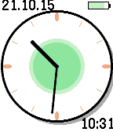

<!-- Generated by scripts/update_app_directory.py: do not edit by hand -->
[← All Pebble Developers](../developers.md)

# Michael

*1 watchface · Last updated 2026-10-12 · [About these lists](../about-app-lists.md)*

Links: [Pebble App Store](https://apps.repebble.com/apps/dev/michael_551803d757efe6acb40000a9) · [GitHub (ylno)](https://github.com/ylno)

<h2 class="app-name" id="app-5589b1d545b5394350000005"><a href="https://apps.repebble.com/5589b1d545b5394350000005">greenclock-face</a> v1.3</h2>
<a class="app-source" href="https://github.com/ylno/greenclock-face" title="Source code" data-search-exclude>View source</a>

Watchface

Released 2015-06-23 Updated 2016-05-24

Runs on: Round 2, Time 2, Time Round, Time

Animated color Pebble watchface. Expands from a dot, sweeping the clock arms as it does so. There are two inner circles inside the clock face. One is filling up the clock face every hour, one for…

