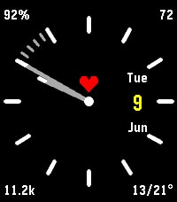

<!-- Generated by scripts/update_app_directory.py: do not edit by hand -->
[← All Pebble Developers](../developers.md)

# Michal Blaha

*1 watchface and 1 app · Last updated 2026-10-12 · [About these lists](../about-app-lists.md)*

Links: [Pebble App Store](https://apps.repebble.com/apps/dev/michal-blaha_f32586e2bb368aa0fb2bc8f9) · [GitHub (michalblaha)](https://github.com/michalblaha)

<button type="button" data-filter="all" aria-pressed="true">All 2</button><button type="button" data-filter="watchface" aria-pressed="false">Watchfaces 1</button><button type="button" data-filter="watchapp" aria-pressed="false">Apps 1</button>

<label class="dev-sort">Sort by <select><option value="updated">Recently updated</option><option value="released">Newest release</option><option value="title">A–Z</option></select></label>

<h2 class="app-name" id="app-913596b1f09d4dab981805b3"><a href="https://apps.repebble.com/913596b1f09d4dab981805b3">GymClock</a> v2.1.1</h2>
<a class="app-source" href="https://github.com/michalblaha/GymClock" title="Source code" data-search-exclude>View source</a>

App

Released 2026-05-30 Updated 2026-06-09

Runs on: Round 2, Time 2

GymClock — your interval &amp; HIIT timer on the wrist. Build a circuit from your own named exercises, set the work time, rest time and number of rounds, then start training without ever touching your…

<h2 class="app-name" id="app-bc521e1f080841449463f74e"><a href="https://apps.repebble.com/bc521e1f080841449463f74e">Crisp</a> v1.3.0</h2>
<a class="app-source" href="https://github.com/michalblaha/Crisp-watchface" title="Source code" data-search-exclude>View source</a>

Watchface

Released 2026-06-05 Updated 2026-06-09

Runs on: Round 2, Time 2, Pebble 2 Duo, Pebble 2, Time Round, Time, Classic

# Crisp — Pebble appstore listing copy ## Title Crisp ## Tagline (one line) Clean analog watchface with thin markers and live info in every corner. ## Short description (~140 chars) A customizable…

