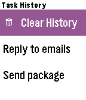

<!-- Generated by scripts/update_app_directory.py: do not edit by hand -->
[← All Pebble Developers](../developers.md)

# Michal Kowalkowski

*1 app · Last updated 2026-10-11 · [About these lists](../about-app-lists.md)*

Links: [Pebble App Store](https://apps.repebble.com/apps/dev/michal-kowalkowski_5668418ca1c34e886900003d) · [GitHub (michalkow)](https://github.com/michalkow)

<h2 class="app-name" id="app-5674333b1caa14bc3500003e"><a href="https://apps.repebble.com/5674333b1caa14bc3500003e">ToDoIt</a> v1.4</h2>
<a class="app-source" href="https://github.com/michalkow/pebble-ToDoIt" title="Source code" data-search-exclude>View source</a>

App

Released 2015-12-18 Updated 2015-12-28

Runs on: Time 2, Pebble 2 Duo, Pebble 2, Time, Classic

ToDoIt is a a checklist app with daily reminders. You can customize few times a day, when you want to be reminded about planned tasks. You can use voice to add new tasks. Easily track what you…

