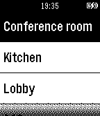

<!-- Generated by scripts/update_app_directory.py: do not edit by hand -->
[← All Pebble Developers](../developers.md)

# Micke Prag

*1 app · Last updated 2026-10-11 · [About these lists](../about-app-lists.md)*

Links: [Pebble App Store](https://apps.repebble.com/apps/dev/micke-prag_52b943fe5dfb6e93f4000049) · [GitHub (mickeprag)](https://github.com/mickeprag)

<h2 class="app-name" id="app-52cc1a8c45ffdd84b5000146"><a href="https://apps.repebble.com/52cc1a8c45ffdd84b5000146">Telldus Live!</a> v1.0.0</h2>
<a class="app-source" href="https://github.com/mickeprag/telldus-live-pebble" title="Source code" data-search-exclude>View source</a>

App

Released 2014-01-07 Updated 2014-01-07

Runs on: Time 2, Pebble 2 Duo, Pebble 2, Time, Classic

Pebble app for connecting to Telldus Live! Control you lights and appliances from your wrist.

