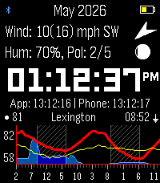

<!-- Generated by scripts/update_app_directory.py: do not edit by hand -->
[← All Pebble Developers](../developers.md)

# Midnight Clocksmith

*1 app · Last updated 2026-10-12 · [About these lists](../about-app-lists.md)*

Links: [Pebble App Store](https://apps.repebble.com/apps/dev/midnight-clocksmith_db7063815e3392824cc53a3e) · [GitHub (the-static)](https://github.com/the-static)

<h2 class="app-name" id="app-bf411784b2584f118a4035d0"><a href="https://apps.repebble.com/bf411784b2584f118a4035d0">ForeCasWatCompanion</a> v1.34.6</h2>
<a class="app-source" href="https://github.com/the-static/forcaswatch3" title="Source code" data-search-exclude>View source</a>

App

Released 2026-05-27 Updated 2026-09-24

Runs on: Time 2

I made a version of the forecaswatch2 watchface that runs as an app, so you can interact with it and have different info. I found that binding the app to a quicklaunch button helps it feel like a…

