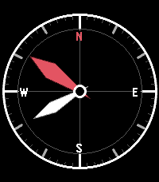

<!-- Generated by scripts/update_app_directory.py: do not edit by hand -->
[← All Pebble Developers](../developers.md)

# Midnight Oscillator

*2 watchfaces · Last updated 2026-10-11 · [About these lists](../about-app-lists.md)*

Links: [Pebble App Store](https://apps.repebble.com/apps/dev/midnight-oscillator_f337572cef4e9221cecbab5c) · [GitHub (coredevices)](https://github.com/coredevices)

<button type="button" data-filter="all" aria-pressed="true">All 2</button><button type="button" data-filter="watchface" aria-pressed="false">Watchfaces 2</button><button type="button" data-filter="watchapp" aria-pressed="false" disabled>Apps 0</button>

<label class="dev-sort">Sort by <select><option value="updated">Recently updated</option><option value="released">Newest release</option><option value="title">A–Z</option></select></label>

<h2 class="app-name" id="app-5f69c7104d554a09ac059281"><a href="https://apps.repebble.com/5f69c7104d554a09ac059281">Compass Time</a> v1.0.0</h2>
<a class="app-source" href="https://github.com/coredevices/pebble-watchface-agent-skill" title="Source code" data-search-exclude>View source</a>

Watchface

Released 2026-04-14 Updated 2026-04-14

Runs on: Round 2, Time 2

A compass-themed watchface where the red hour needle points north and the white minute needle points south. Features N/S/E/W cardinal labels, classic compass bezel with tick marks, and full-screen…

<h2 class="app-name" id="app-003f0ed2b7c84ecfa57bca1a"><a href="https://apps.repebble.com/003f0ed2b7c84ecfa57bca1a">Line and Dot</a> v1.1.0</h2>
<a class="app-source" href="https://github.com/coredevices/pebble-watchface-agent-skill" title="Source code" data-search-exclude>View source</a>

Watchface

Released 2026-04-08 Updated 2026-04-08

Runs on: Round 2, Time 2

Minimalist analog watchface with a white hour hand and red dot orbiting the dial edge. Colors are fully customizable via settings.

