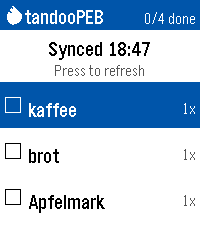

<!-- Generated by scripts/update_app_directory.py: do not edit by hand -->
[← All Pebble Developers](../developers.md)

# Midnight Sundial

*1 app · Last updated 2026-10-11 · [About these lists](../about-app-lists.md)*

Links: [Pebble App Store](https://apps.repebble.com/apps/dev/midnight-sundial_75856ef28558d9ebe93a64da) · [GitHub (Carunga)](https://github.com/Carunga)

<h2 class="app-name" id="app-8f1c74a599ba4c1abe9f6428"><a href="https://apps.repebble.com/8f1c74a599ba4c1abe9f6428">tandooPEB</a> v0.2.0</h2>
<a class="app-source" href="https://github.com/Carunga/tandooPEB" title="Source code" data-search-exclude>View source</a>

App

GPL-3.0 Released 2026-09-17 Updated 2026-09-17

Runs on: Time 2

Another shopping list for the Pebble Time 2. This one syncs with your Tandoor Recipie Manager (https://github.com/TandoorRecipes/recipes). Only one basic shopping list without catagories is…

