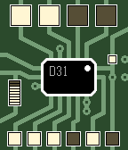

<!-- Generated by scripts/update_app_directory.py: do not edit by hand -->
[← All Pebble Developers](../developers.md)

# MidnightLightning

*1 watchface · Last updated 2026-10-12 · [About these lists](../about-app-lists.md)*

Links: [Pebble App Store](https://apps.repebble.com/apps/dev/midnightlightning_565cb0ca96fbfc891a00006e) · [GitHub (MidnightLightning)](https://github.com/MidnightLightning) · [Website (midnight.design)](http://midnight.design/binary-watchface/)

<h2 class="app-name" id="app-5684d175b35693b46700009c"><a href="https://apps.repebble.com/5684d175b35693b46700009c">Binary Circuit</a> v1.0</h2>
<a class="app-source" href="https://github.com/MidnightLightning/BinaryWatchface" title="Source code" data-search-exclude>View source</a>

Watchface

No licence Released 2015-12-31 Updated 2015-12-31

Runs on: Round 2, Time 2, Pebble 2 Duo, Pebble 2, Time Round, Time, Classic

Inspired by a binary watch I owned that used real LEDs to show the hours and minutes, this watchface gives the illusion of a bare circuit board and LEDs to show the time. Additional indicators for…

