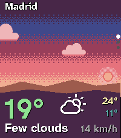
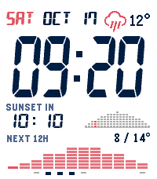
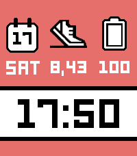
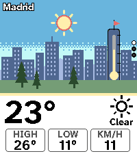

<!-- Generated by scripts/update_app_directory.py: do not edit by hand -->
[← All Pebble Developers](../developers.md)

# Miguel Angel Baeyens

*2 watchfaces and 2 apps · Last updated 2026-11-02 · [About these lists](../about-app-lists.md)*

Links: [Pebble App Store](https://apps.repebble.com/apps/dev/miguel-angel-baeyens_1147b782781f1f1115f63f5b) · [GitHub (mabaeyens)](https://github.com/mabaeyens) · [Website (askmira.es)](https://askmira.es/aura/pebble)

<button type="button" data-filter="all" aria-pressed="true">All 4</button><button type="button" data-filter="watchface" aria-pressed="false">Watchfaces 2</button><button type="button" data-filter="watchapp" aria-pressed="false">Apps 2</button>

<label class="dev-sort">Sort by <select><option value="updated">Recently updated</option><option value="released">Newest release</option><option value="title">A–Z</option></select></label>

<h2 class="app-name" id="app-0a9a48594f2845d4a911ff41"><a href="https://apps.repebble.com/0a9a48594f2845d4a911ff41">Aura Sky Weather</a> v1.0.1</h2>
<a class="app-source" href="https://github.com/mabaeyens/aura-pebble" title="Source code" data-search-exclude>View source</a>

App

MIT Released 2026-10-17 Updated 2026-10-17

Runs on: Time 2

The dashboard limit is 1,600 characters (per the official Pebble docs); this text is under it. Aura Sky Weather turns the weather into a sky. The whole screen is a sky painted from the real time…

<h2 class="app-name" id="app-75df0aa5863e415eaa84c66b"><a href="https://apps.repebble.com/75df0aa5863e415eaa84c66b">Aura LCD</a> v1.4</h2>
<a class="app-source" href="https://github.com/mabaeyens/aura-pebble/tree/main/aura-led-CGW-50" title="Source code" data-search-exclude>View source</a>

Watchface

MIT Released 2026-10-17 Updated 2026-10-17

Runs on: Time 2

Aura LCD is the LCD watch I wanted as a kid, rebuilt for the Pebble Time 2. The time is drawn in sharp, slanted 7-segment digits, the date in 14-segment letters, all rendered pixel by pixel so the…

<h2 class="app-name" id="app-19335d2e746b4d6aa6ba8c63"><a href="https://apps.repebble.com/19335d2e746b4d6aa6ba8c63">Aura Essential</a> v1.5.0</h2>
<a class="app-source" href="https://github.com/mabaeyens/aura-pebble" title="Source code" data-search-exclude>View source</a>

Watchface

MIT Released 2026-09-02 Updated 2026-10-17

Runs on: Time 2

This face is my homage to Essential by Kiezel, one of my favourite watchfaces on the original Pebble and Pebble Time, the Kickstarter watches I backed, bought and gifted a few of. Essential has…

<h2 class="app-name" id="app-f96217ed9b8a41bfb25e2700"><a href="https://apps.repebble.com/f96217ed9b8a41bfb25e2700">Aura Cityscape Weather</a> v1.0.0</h2>
<a class="app-source" href="https://github.com/mabaeyens/aura-pebble" title="Source code" data-search-exclude>View source</a>

App

MIT Released 2026-10-17 Updated 2026-10-17

Runs on: Time 2

Aura Cityscape Weather turns the forecast into a small town. The sun or the moon rides its real arc over the skyline, and the sky and every layer of the scene change with the hour, from dawn…

