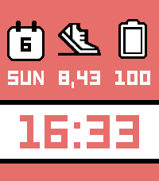

<!-- Generated by scripts/update_app_directory.py: do not edit by hand -->
[← All Pebble Developers](../developers.md)

# Miguel Angel Baeyens

*1 watchface and 1 app · Last updated 2026-10-12 · [About these lists](../about-app-lists.md)*

Links: [Pebble App Store](https://apps.repebble.com/apps/dev/miguel-angel-baeyens_1147b782781f1f1115f63f5b) · [GitHub (mabaeyens)](https://github.com/mabaeyens) · [Website (askmira.es)](https://askmira.es/aura)

<button type="button" data-filter="all" aria-pressed="true">All 2</button><button type="button" data-filter="watchface" aria-pressed="false">Watchfaces 1</button><button type="button" data-filter="watchapp" aria-pressed="false">Apps 1</button>

<label class="dev-sort">Sort by <select><option value="updated">Recently updated</option><option value="released">Newest release</option><option value="title">A–Z</option></select></label>

<h2 class="app-name" id="app-19335d2e746b4d6aa6ba8c63"><a href="https://apps.repebble.com/19335d2e746b4d6aa6ba8c63">Aura Essential</a> v1.4.0</h2>
<a class="app-source" href="https://github.com/mabaeyens/aura-pebble" title="Source code" data-search-exclude>View source</a>

Watchface

Released 2026-09-02 Updated 2026-09-09

Runs on: Time 2

This face is my homage to Essential by Kiezel, one of my favourite watchfaces on the original Pebble and Pebble Time, the Kickstarter watches I backed, bought and gifted a few of. Essential has…

<h2 class="app-name" id="app-1d7ab48a02de4a58a95732d7"><a href="https://apps.repebble.com/1d7ab48a02de4a58a95732d7">Aura Weather</a> v1.1.0</h2>
<a class="app-source" href="https://github.com/mabaeyens/aura-pebble/aura-weather" title="Source code" data-search-exclude>View source</a>

App

Released 2026-09-05 Updated 2026-09-05

Runs on: Time 2

Aura Weather carries my Spain weather app&#x27;s design language onto the Pebble Time 2: a living sky you read at a glance. The hero screen draws the sun (a moon at night) arcing over a day-to-night…

