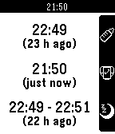

<!-- Generated by scripts/update_app_directory.py: do not edit by hand -->
[← All Pebble Developers](../developers.md)

# Miguel Branco

*1 app · Last updated 2026-10-12 · [About these lists](../about-app-lists.md)*

Links: [Pebble App Store](https://apps.repebble.com/apps/dev/miguel-branco_531a5e8d5ef1cb5a08000307) · [GitHub (Arlanthir)](https://github.com/Arlanthir) · [Website (forum.xda-developers.com)](http://forum.xda-developers.com/pebble/pebble-development/pebby-baby-helper-t2850395)

<h2 class="app-name" id="app-53fbc513994475c7ee0001ed"><a href="https://apps.repebble.com/53fbc513994475c7ee0001ed">Baby Watch</a> v1.4</h2>
<a class="app-source" href="https://github.com/Arlanthir/pebby" title="Source code" data-search-exclude>View source</a>

App

No licence Released 2014-08-25 Updated 2015-09-10

Runs on: Time 2, Pebble 2 Duo, Pebble 2, Time, Classic

Baby Watch helps you take care of your baby. It allows you to easily set the last time the baby slept, ate or had its diaper changed. Glance down and check how long it has been since any of those…

