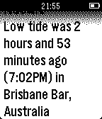
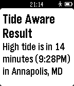

<!-- Generated by scripts/update_app_directory.py: do not edit by hand -->
[← All Pebble Developers](../developers.md)

# Mike Dombrowski

*2 apps · Last updated 2026-10-11 · [About these lists](../about-app-lists.md)*

Links: [Pebble App Store](https://apps.repebble.com/apps/dev/mike-dombrowski_52f147b9537d3070a3000148) · [GitHub (md100play)](https://github.com/md100play) · [Website (mikedombrowski.com)](http://mikedombrowski.com/projects/pebbletides-pebble-smartwatch-app/)

<button type="button" data-filter="all" aria-pressed="true">All 2</button><button type="button" data-filter="watchface" aria-pressed="false" disabled>Watchfaces 0</button><button type="button" data-filter="watchapp" aria-pressed="false">Apps 2</button>

<label class="dev-sort">Sort by <select><option value="updated">Recently updated</option><option value="released">Newest release</option><option value="title">A–Z</option></select></label>

<h2 class="app-name" id="app-5360443e43c553e46a000023"><a href="https://apps.repebble.com/5360443e43c553e46a000023">Tide Aware (Non-US)</a> v2.11</h2>
<a class="app-source" href="https://github.com/md100play/PebbleTides-Non-US" title="Source code" data-search-exclude>View source</a>

App

Released 2014-04-30 Updated 2016-06-11

Runs on: Round 2, Time 2, Pebble 2 Duo, Pebble 2, Time Round, Time, Classic

Tide Aware now supports thousands of locations outside of the US. Tide Aware is the incredibly simple way to check the closest tides based on locations input by the user through the Pebble…

<h2 class="app-name" id="app-530e9f7f306a45f5bc00003f"><a href="https://apps.repebble.com/530e9f7f306a45f5bc00003f">Tide Aware</a> v3.11</h2>
<a class="app-source" href="https://github.com/md100play/PebbleTides-WatchApp" title="Source code" data-search-exclude>View source</a>

App

Released 2014-02-27 Updated 2016-06-11

Runs on: Round 2, Time 2, Pebble 2 Duo, Pebble 2, Time Round, Time, Classic

**US Only** Tide Aware is the incredibly simple way to check the closest tides based on GPS, ZIP Codes, or city and state input by the user through the Pebble configuration feature. Now includes…

