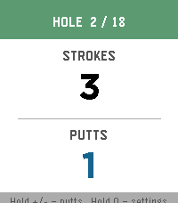

<!-- Generated by scripts/update_app_directory.py: do not edit by hand -->
[← All Pebble Developers](../developers.md)

# Mike Eberlein

*1 app · Last updated 2026-10-11 · [About these lists](../about-app-lists.md)*

Links: [Pebble App Store](https://apps.repebble.com/apps/dev/mike-eberlein_1b65fdee9d55d8d8591cf44e)

<h2 class="app-name" id="app-d1ab3c97db27469386546977"><a href="https://apps.repebble.com/d1ab3c97db27469386546977">Golf Score</a> v1.0.2</h2>
<a class="app-source" href="https://git.mikeeberlein.com/meberlein/PebbleGolfScore" title="Source code" data-search-exclude>View source</a>

App

Released 2026-05-11 Updated 2026-05-25

Runs on: Round 2, Time 2, Pebble 2 Duo, Pebble 2, Time Round, Time

An app to track golf score (strokes and putts) Open source here: https://git.mikeeberlein.com/meberlein/PebbleGolfScore/src/branch/master

