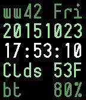

<!-- Generated by scripts/update_app_directory.py: do not edit by hand -->
[← All Pebble Developers](../developers.md)

# Mike Hix

*1 watchface · Last updated 2026-10-12 · [About these lists](../about-app-lists.md)*

Links: [Pebble App Store](https://apps.repebble.com/apps/dev/mike-hix_55d89202dd77766ad6000008) · [GitHub (musl)](https://github.com/musl)

<h2 class="app-name" id="app-562bf028e1455333640000c4"><a href="https://apps.repebble.com/562bf028e1455333640000c4">DataFace</a> v0.6</h2>
<a class="app-source" href="http://github.com/musl/DataFace" title="Source code" data-search-exclude>View source</a>

Watchface

No licence Released 2015-10-24 Updated 2016-12-05

Runs on: Time 2, Time

A terse, no-foolin&#x27;, nerdy watchface for utilitarian types. You&#x27;ll need to plug in your OpenWeatherMap AppID after you install this. New in v0.6: Bug fixes and a nicer looking configuration page…

