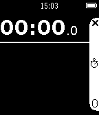
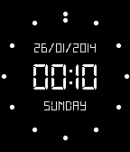
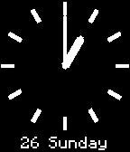
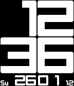

<!-- Generated by scripts/update_app_directory.py: do not edit by hand -->
[← All Pebble Developers](../developers.md)

# MikeM

*4 apps · Last updated 2026-10-12 · [About these lists](../about-app-lists.md)*

Links: [Pebble App Store](https://apps.repebble.com/apps/dev/mikem_5299a2ae129af7accf00005c) · [GitHub (MikeMoore63)](https://github.com/MikeMoore63)

<button type="button" data-filter="all" aria-pressed="true">All 4</button><button type="button" data-filter="watchface" aria-pressed="false" disabled>Watchfaces 0</button><button type="button" data-filter="watchapp" aria-pressed="false">Apps 4</button>

<label class="dev-sort">Sort by <select><option value="updated">Recently updated</option><option value="released">Newest release</option><option value="title">A–Z</option></select></label>

<h2 class="app-name" id="app-52e52bd98af5795fcc0005c9"><a href="https://apps.repebble.com/52e52bd98af5795fcc0005c9">Yacht Timer</a> v7.0</h2>
<a class="app-source" href="https://github.com/MikeMoore63/yachttimer" title="Source code" data-search-exclude>View source</a>

App

No licence Released 2014-01-26 Updated 2015-05-05

Runs on: Time 2, Pebble 2 Duo, Pebble 2, Time, Classic

Simple app supporting Yacht Racing countdown timer, StopWatch, Countdow and Watch. Countdown supports adjustments by Hours, Minutes, Seconds. Vibrate on signifigant Times e.g. 4 minute gun, 1…

<h2 class="app-name" id="app-52e541bd56101313b2000650"><a href="https://apps.repebble.com/52e541bd56101313b2000650">Studio Watch, StopWatch, Countdown, Yacht Timer</a> v3.1</h2>
<a class="app-source" href="https://github.com/MikeMoore63/Studiosw" title="Source code" data-search-exclude>View source</a>

App

No licence Released 2014-01-26 Updated 2015-05-05

Runs on: Time 2, Pebble 2 Duo, Pebble 2, Time, Classic

Stylish - Multi-function stopwatch, watch, countdown timer, yacht timer with adjustments and vibration on key times.

<h2 class="app-name" id="app-52e5449b97213707e00005b8"><a href="https://apps.repebble.com/52e5449b97213707e00005b8">Simple Analogue Watch, Stop Watch, Countdown Yacht Timer</a> v3.0</h2>
<a class="app-source" href="https://github.com/MikeMoore63/swanalog" title="Source code" data-search-exclude>View source</a>

App

No licence Released 2014-01-26 Updated 2015-05-05

Runs on: Time 2, Pebble 2 Duo, Pebble 2, Time, Classic

A simple analog Watch, Countdown, Stop Watch, Yacht Timer with countdown adjustment. Vibrates at key times i.e. in Yacht Timer mode 4 minutes 1 minutes, 30 seconds, 20 secs, 10 secs, start.

<h2 class="app-name" id="app-52e52eff97213707e0000595"><a href="https://apps.repebble.com/52e52eff97213707e0000595">Revolution YachtTimer, StopWatch, Countdown, Yacht Timer</a> v3.1</h2>
<a class="app-source" href="https://github.com/MikeMoore63/RevolutionStopWatch" title="Source code" data-search-exclude>View source</a>

App

No licence Released 2014-01-26 Updated 2015-05-05

Runs on: Time 2, Pebble 2 Duo, Pebble 2, Time, Classic

A version of Revolution Watch but as an App with Stopwatch, countdown, YachtTimer and Adjustment features.

