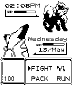

<!-- Generated by scripts/update_app_directory.py: do not edit by hand -->
[← All Pebble Developers](../developers.md)

# Miro

*1 watchface · Last updated 2026-10-12 · [About these lists](../about-app-lists.md)*

Links: [Pebble App Store](https://apps.repebble.com/apps/dev/miro_544c31cdf1ebd0f934000001) · [Website (miroppb.com)](http://www.miroppb.com/projects/pkmn_battle)

<h2 class="app-name" id="app-554d0edf9285710c04000059"><a href="https://apps.repebble.com/554d0edf9285710c04000059">PKMN BATTLE</a> v1.4</h2>
<a class="app-source" href="http://www.miroppb.com/code/pkmn.c" title="Source code" data-search-exclude>View source</a>

Watchface

Released 2015-05-08 Updated 2015-06-22

Runs on: Time 2, Pebble 2 Duo, Pebble 2, Time, Classic

Simple Watchface of a Pokemon Battle. Displays the time, day of the week, day of the month, month, the percentage of battery (+ if charging), smiling and sad faces for when the watch is connected…

