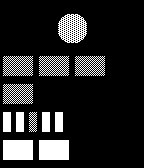

<!-- Generated by scripts/update_app_directory.py: do not edit by hand -->
[← All Pebble Developers](../developers.md)

# Mitch Patenaude

*1 watchface · Last updated 2026-10-12 · [About these lists](../about-app-lists.md)*

Links: [Pebble App Store](https://apps.repebble.com/apps/dev/mitch-patenaude_52e4516e34ba664fc8000c3f) · [GitHub (pneumaticdeath)](https://github.com/pneumaticdeath) · [Website (en.wikipedia.org)](http://en.wikipedia.org/wiki/Berlin_Clock)

<h2 class="app-name" id="app-52e4522b34ba6657d7000cd7"><a href="https://apps.repebble.com/52e4522b34ba6657d7000cd7">Berlin Clock</a> v1.0.1</h2>
<a class="app-source" href="https://github.com/pneumaticdeath/berlin_clock" title="Source code" data-search-exclude>View source</a>

Watchface

Released 2014-01-26 Updated 2014-02-22

Runs on: Time 2, Pebble 2 Duo, Pebble 2, Time, Classic

An implementation of the famous Berlin clock. Misnamed the Mengenlehreuhr, or &quot;set theory clock&quot;, it uses a series of blocks to represent the time in 24h format. The circle at the top blinks with…

