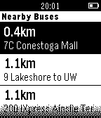

<!-- Generated by scripts/update_app_directory.py: do not edit by hand -->
[← All Pebble Developers](../developers.md)

# Mitchell Van Der Hoeff

*1 app · Last updated 2026-10-12 · [About these lists](../about-app-lists.md)*

Links: [Pebble App Store](https://apps.repebble.com/apps/dev/mitchell-van-der-hoeff_545fac88f520d9d228000086) · [GitHub (mvanderh)](https://github.com/mvanderh)

<h2 class="app-name" id="app-54694ee5bfc6a28d0300004f"><a href="https://apps.repebble.com/54694ee5bfc6a28d0300004f">PebbleGRT</a> v0.3</h2>
<a class="app-source" href="https://github.com/mvanderh/PebbleGRT/" title="Source code" data-search-exclude>View source</a>

App

Released 2014-11-17 Updated 2014-11-23

Runs on: Time 2, Pebble 2 Duo, Pebble 2, Time, Classic

Check real time bus times and distances for GRT in the Kitchener/Waterloo area! - Click on a Nearby Bus to see Delay and Upcoming Stops - Click on a Nearby Stop to see Upcoming Buses

