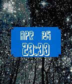
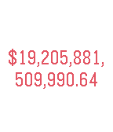
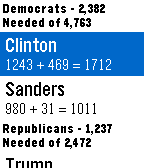

<!-- Generated by scripts/update_app_directory.py: do not edit by hand -->
[← All Pebble Developers](../developers.md)

# MittuDev

*2 watchfaces and 3 apps · Last updated 2026-10-12 · [About these lists](../about-app-lists.md)*

Links: [Pebble App Store](https://apps.repebble.com/apps/dev/mittudev_5659e669c1b6ceb64b000081) · [GitHub (nmittu)](https://github.com/nmittu) · [Website (mittudev.com)](http://www.mittudev.com/)

<button type="button" data-filter="all" aria-pressed="true">All 5</button><button type="button" data-filter="watchface" aria-pressed="false">Watchfaces 2</button><button type="button" data-filter="watchapp" aria-pressed="false">Apps 3</button>

<label class="dev-sort">Sort by <select><option value="updated">Recently updated</option><option value="released">Newest release</option><option value="title">A–Z</option></select></label>

<h2 class="app-name" id="app-571ee254b38a7d445b000014"><a href="https://apps.repebble.com/571ee254b38a7d445b000014">Starry</a> v1.1</h2>
<a class="app-source" href="https://github.com/nmittu/starry" title="Source code" data-search-exclude>View source</a>

Watchface

Released 2016-04-26 Updated 2016-04-26

Runs on: Round 2, Time 2, Pebble 2 Duo, Pebble 2, Time Round, Time, Classic

Watchface that shows you images of stars. Shows a different image every time the watchface reloads.

<h2 class="app-name" id="app-571bf97f19c7adbfc5000017"><a href="https://apps.repebble.com/571bf97f19c7adbfc5000017">Nixie Watch</a> v2.2</h2>
<a class="app-source" href="https://github.com/nmittu/Nixie-Watch" title="Source code" data-search-exclude>View source</a>

Watchface

Released 2016-04-23 Updated 2016-04-25

Runs on: Round 2, Time 2, Pebble 2 Duo, Pebble 2, Time Round, Time, Classic

Nixie watchface for the pebble. You can make the watchface vibrate after a certain amount of time in the config page. Includes a connection indicator, battery indicator, and step counter…

<h2 class="app-name" id="app-5716e62fe0e8f34571000001"><a href="https://apps.repebble.com/5716e62fe0e8f34571000001">News</a> v1.0</h2>
<a class="app-source" href="https://github.com/nmittu/Pebble-News" title="Source code" data-search-exclude>View source</a>

App

Released 2016-04-20 Updated 2016-04-20

Runs on: Round 2, Time 2, Pebble 2 Duo, Pebble 2, Time Round, Time, Classic

View most popular news from the New York Times API. -API keys are needed from http://developer.nytimes.com/docs

<h2 class="app-name" id="app-571188b8c96f2e474e000003"><a href="https://apps.repebble.com/571188b8c96f2e474e000003">Debt Clock</a> v1.0</h2>
<a class="app-source" href="https://github.com/nmittu/DebtClock" title="Source code" data-search-exclude>View source</a>

App

Released 2016-04-16 Updated 2016-04-16

Runs on: Round 2, Time 2, Pebble 2 Duo, Pebble 2, Time Round, Time, Classic

Live US national debt clock.

<h2 class="app-name" id="app-5704637a0239f18ed9000013"><a href="https://apps.repebble.com/5704637a0239f18ed9000013">Delegate Tracker</a> v1.0</h2>
<a class="app-source" href="https://github.com/nmittu/2016-Delegate-Tracker" title="Source code" data-search-exclude>View source</a>

App

Released 2016-04-06 Updated 2016-04-06

Runs on: Round 2, Time 2, Pebble 2 Duo, Pebble 2, Time Round, Time, Classic

Tracks the delegate count of the 2016 presidential candidates.

