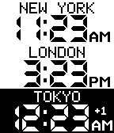
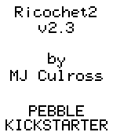
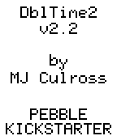
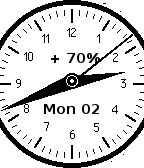

<!-- Generated by scripts/update_app_directory.py: do not edit by hand -->
[← All Pebble Developers](../developers.md)

# mjculross

*1 watchface and 3 apps · Last updated 2026-10-12 · [About these lists](../about-app-lists.md)*

Links: [Pebble App Store](https://apps.repebble.com/apps/dev/mjculross_52998a08e627ced73e000037) · [GitHub (mjculross)](https://github.com/mjculross)

<button type="button" data-filter="all" aria-pressed="true">All 4</button><button type="button" data-filter="watchface" aria-pressed="false">Watchfaces 1</button><button type="button" data-filter="watchapp" aria-pressed="false">Apps 3</button>

<label class="dev-sort">Sort by <select><option value="updated">Recently updated</option><option value="released">Newest release</option><option value="title">A–Z</option></select></label>

<h2 class="app-name" id="app-52ef2157c503c8acee000008"><a href="https://apps.repebble.com/52ef2157c503c8acee000008">TZplus2</a> v2.2.0</h2>
<a class="app-source" href="https://www.github.com/mjculross/TZplus2" title="Source code" data-search-exclude>View source</a>

App

Released 2014-02-03 Updated 2014-02-03

Runs on: Time 2, Pebble 2 Duo, Pebble 2, Time, Classic

TZplus2: display multiple configurable timezones

<h2 class="app-name" id="app-52ef1b925931845564000005"><a href="https://apps.repebble.com/52ef1b925931845564000005">Ricochet2</a> v2.3.0</h2>
<a class="app-source" href="https://www.github.com/mjculross/Ricochet2" title="Source code" data-search-exclude>View source</a>

App

Released 2014-02-03 Updated 2014-02-03

Runs on: Time 2, Pebble 2 Duo, Pebble 2, Time, Classic

Ricochet2: time &amp; date bounce around the screen &amp; ricochet off of each other

<h2 class="app-name" id="app-52ef24152823060c08000002"><a href="https://apps.repebble.com/52ef24152823060c08000002">DblTime2</a> v2.2.0</h2>
<a class="app-source" href="https://www.github.com/mjculross/DblTime2" title="Source code" data-search-exclude>View source</a>

App

Released 2014-02-03 Updated 2014-02-03

Runs on: Time 2, Pebble 2 Duo, Pebble 2, Time, Classic

DblTime2: display two configurable timezones

<h2 class="app-name" id="app-52ef2bb82823067eb600000b"><a href="https://apps.repebble.com/52ef2bb82823067eb600000b">Chrono2</a> v2.2.0</h2>
<a class="app-source" href="https://www.github.com/mjculross/Chrono2" title="Source code" data-search-exclude>View source</a>

Watchface

Released 2014-02-03 Updated 2014-02-03

Runs on: Time 2, Pebble 2 Duo, Pebble 2, Time, Classic

Chrono2: A &quot;sweep analog&quot; watchface with a smooth second hand NOTE: due to the high update rate of the display, Chrono2 is likely to deplete your Pebble battery quicker than other watchfaces Mark…

