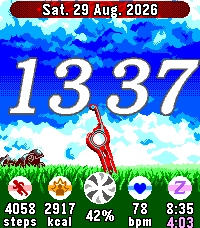

<!-- Generated by scripts/update_app_directory.py: do not edit by hand -->
[← All Pebble Developers](../developers.md)

# MK73DS

*1 watchface · Last updated 2026-10-11 · [About these lists](../about-app-lists.md)*

Links: [Pebble App Store](https://apps.repebble.com/apps/dev/mk73ds_aafd215fb48d30afcabd54eb) · [GitHub (MK73DS)](https://github.com/MK73DS) · [Website (youtube.com)](https://www.youtube.com/playlist?list=PLYrPlgW_OgVk)

<h2 class="app-name" id="app-254e66f253cd44edaf11e5d2"><a href="https://apps.repebble.com/254e66f253cd44edaf11e5d2">Xenoblade Chronicles</a> v1.2.3</h2>
<a class="app-source" href="https://github.com/MK73DS/xenoblade_watchface" title="Source code" data-search-exclude>View source</a>

Watchface · <a href="https://forum.rebble.io/t/1294" title="Discuss this app on the Rebble forum" data-search-exclude>Forum thread</a>

No licence Released 2026-08-23 Updated 2026-09-05

Runs on: Time 2

~~ Xenoblade Chronicles watchface for Pebble Time 2 ~~ A Pebble watchface for the Pebble Time 2 only, featuring a beautiful theme from the video game Xenoblade Chronicles! =&gt; Features - Time and…

