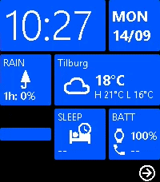
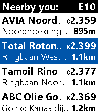
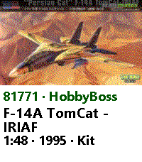
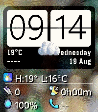
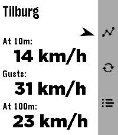

<!-- Generated by scripts/update_app_directory.py: do not edit by hand -->
[← All Pebble Developers](../developers.md)

# Moaske

*3 watchfaces and 4 apps · Last updated 2026-10-11 · [About these lists](../about-app-lists.md)*

Links: [Pebble App Store](https://apps.repebble.com/apps/dev/moaske_3f1bf0845ffec82a2a96f91c) · [GitHub (Moaske)](https://github.com/Moaske)

<button type="button" data-filter="all" aria-pressed="true">All 7</button><button type="button" data-filter="watchface" aria-pressed="false">Watchfaces 3</button><button type="button" data-filter="watchapp" aria-pressed="false">Apps 4</button>

<label class="dev-sort">Sort by <select><option value="updated">Recently updated</option><option value="released">Newest release</option><option value="title">A–Z</option></select></label>

<h2 class="app-name" id="app-b406d87ebcd144ff9cd278a3"><a href="https://apps.repebble.com/b406d87ebcd144ff9cd278a3">Metro WP8</a> v1.6.8</h2>
<a class="app-source" href="https://github.com/Moaske/PebbleMetroWP8" title="Source code" data-search-exclude>View source</a>

Watchface

No licence Released 2026-08-07 Updated 2026-10-09

Runs on: Time 2, Time

Retro Windows Phone 8 watchface with the original Metro WP8 tiles design! 📱 NEW! Selectable Live Tiles! --- Supports Basalt (Time/Time Steel) and Emery (Time 2). Features: 🔶 Large clock and…

<h2 class="app-name" id="app-3be6709f07634c0d9f9674a1"><a href="https://apps.repebble.com/3be6709f07634c0d9f9674a1">FuelWatch</a> v1.2.2</h2>
<a class="app-source" href="https://github.com/Moaske/PebbleFuelWatch" title="Source code" data-search-exclude>View source</a>

App

No licence Released 2026-09-13 Updated 2026-10-09

Runs on: Time 2, Pebble 2 Duo, Pebble 2, Time

A Pebble nearby fuel station finder for Europe with price check, which kindly and gratefully uses the ANWB© fuel prices api. Watch compatibilty: Basalt, Diorite, Emery and Flint. Features: ⛽ Main…

<h2 class="app-name" id="app-38c21e95638449e5a7eedb8d"><a href="https://apps.repebble.com/38c21e95638449e5a7eedb8d">Hackers95</a> v1.5.1</h2>
<a class="app-source" href="https://github.com/Moaske/PebbleHackers95" title="Source code" data-search-exclude>View source</a>

Watchface

No licence Released 2026-08-12 Updated 2026-09-19

Runs on: Time 2

Hackers &#x27;95 fan watch face featuring nine wallpapers from the movie 😎💾 Hack the planet!! Clock and date follow localisation settings and at bottom: steps, sleep and battery. (Time 2 / Emery only)…

<h2 class="app-name" id="app-938ab8920dc84e6ca776a751"><a href="https://apps.repebble.com/938ab8920dc84e6ca776a751">Scalemates</a> v1.0.5</h2>
<a class="app-source" href="https://github.com/Moaske/PebbleScalemates" title="Source code" data-search-exclude>View source</a>

App

No licence Released 2026-09-05 Updated 2026-09-06

Runs on: Time 2

Scalemates profile viewer for having your Stash and Wishlist lists at hand when out and about ✈️on scalemodelling events 🛩️ or fairs. #ModelAircraft #ScaleModelling I know, pretty niche; you gotta…

<h2 class="app-name" id="app-9b7ac780780d485ba043c9d0"><a href="https://apps.repebble.com/9b7ac780780d485ba043c9d0">Sense Time</a> v1.1.3</h2>
<a class="app-source" href="https://github.com/Moaske/PebbleSenseTime" title="Source code" data-search-exclude>View source</a>

Watchface

No licence Released 2026-08-18 Updated 2026-08-22

Runs on: Time 2

HTC Sense watchface with that legendary Flip Clock widget of the good old days when you could find this on both Android and Windows Mobile phones 🤖🪟 (For Time2 / Emery only) ☀️ Large Flip Clock…

<h2 class="app-name" id="app-363491e5fad345dcbc8eb552"><a href="https://apps.repebble.com/363491e5fad345dcbc8eb552">AQI Monitor</a> v1.5.4</h2>
<a class="app-source" href="https://github.com/Moaske/PebbleAIQmonitor" title="Source code" data-search-exclude>View source</a>

App

No licence Released 2026-07-31 Updated 2026-08-13

Runs on: Time 2

Air Quality and Pollen monitor for Pebble Time 2 (Emery) Features: 🔶 Main screen shows current PM2.5, PM10, NO2, Ozone (O3) polutant values as wel as Temperature in Celsius and UV Index for your…

<h2 class="app-name" id="app-bef46f4d7aba46eaa0628ebf"><a href="https://apps.repebble.com/bef46f4d7aba46eaa0628ebf">WindSock</a> v1.7.0</h2>
<a class="app-source" href="https://github.com/Moaske/PebbleWindsock" title="Source code" data-search-exclude>View source</a>

App

No licence Released 2026-07-23 Updated 2026-08-12

Runs on: Time 2, Pebble 2 Duo, Pebble 2, Time, Classic

WindSock is a basic location based wind Forecast app that I made mainly for my drone flying. But I&#x27;d imagine it being useful for many outdoor activities 🚁⛵😎 Watch: 🔶 Main screen shows current wind…

