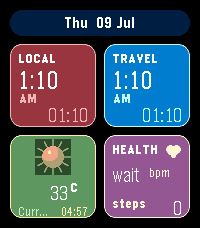

<!-- Generated by scripts/update_app_directory.py: do not edit by hand -->
[← All Pebble Developers](../developers.md)

# Moayadstar

*1 watchface · Last updated 2026-10-11 · [About these lists](../about-app-lists.md)*

Links: [Pebble App Store](https://apps.repebble.com/apps/dev/moayadstar_e65f65b4d4790fae3f80a69f) · [GitHub (moayadstar)](https://github.com/moayadstar)

<h2 class="app-name" id="app-3c9189448a434327986ef1dd"><a href="https://apps.repebble.com/3c9189448a434327986ef1dd">Travel-Local GMT</a> v1.0.23</h2>
<a class="app-source" href="https://github.com/moayadstar/pebble-time2-dashboard" title="Source code" data-search-exclude>View source</a>

Watchface

Released 2026-07-09 Updated 2026-07-09

Runs on: Round 2, Time 2, Pebble 2 Duo, Pebble 2, Time Round, Time, Classic

A colorful Pebble Time 2 dashboard watchface with local time, travel time, date, live weather, heart rate, and step tracking. Includes searchable city settings, current phone location weather, and…

