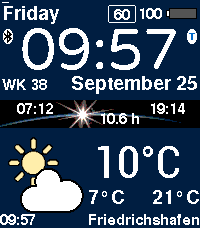

<!-- Generated by scripts/update_app_directory.py: do not edit by hand -->
[← All Pebble Developers](../developers.md)

# Mobile to Go

*1 watchface · Last updated 2026-10-12 · [About these lists](../about-app-lists.md)*

Links: [Pebble App Store](https://apps.repebble.com/apps/dev/mobile-to-go_52caa21ed088ea211600005f) · [GitHub (MobiletoGo)](https://github.com/MobiletoGo) · [Website (mobile-to-go.de)](http://www.mobile-to-go.de/index.php?id=75)

<h2 class="app-name" id="app-52ff653c57610081c7000088"><a href="https://apps.repebble.com/52ff653c57610081c7000088">InfoWatch</a> v7.0</h2>
<a class="app-source" href="https://github.com/MobiletoGo/Pebble-InfoWatch" title="Source code" data-search-exclude>View source</a>

Watchface · <a href="https://forum.rebble.io/t/1386" title="Discuss this app on the Rebble forum" data-search-exclude>Forum thread</a>

GPL-3.0 Released 2014-02-15 Updated 2026-09-28

Runs on: Round 2, Time 2, Pebble 2 Duo, Pebble 2, Time Round, Time, Classic

A smartwatch displaying a wealth of information from the internet or Pebble Health. It offers a notification service and displays the time, day of the week, calendar and date (in almost any…

