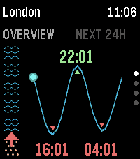
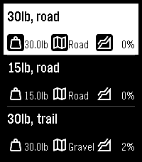

<!-- Generated by scripts/update_app_directory.py: do not edit by hand -->
[← All Pebble Developers](../developers.md)

# ModusApps

*1 watchface and 2 apps · Last updated 2026-10-11 · [About these lists](../about-app-lists.md)*

Links: [Pebble App Store](https://apps.repebble.com/apps/dev/modusapps_57f55e314529f5b84f00003f) · [GitHub (gordonbazeley)](https://github.com/gordonbazeley)

<button type="button" data-filter="all" aria-pressed="true">All 3</button><button type="button" data-filter="watchface" aria-pressed="false">Watchfaces 1</button><button type="button" data-filter="watchapp" aria-pressed="false">Apps 2</button>

<label class="dev-sort">Sort by <select><option value="updated">Recently updated</option><option value="released">Newest release</option><option value="title">A–Z</option></select></label>

<h2 class="app-name" id="app-5dd24e3290e8451781d0df7c"><a href="https://apps.repebble.com/5dd24e3290e8451781d0df7c">TidePebble</a> v1.1.0</h2>
<a class="app-source" href="https://github.com/gordonbazeley/tidepebble" title="Source code" data-search-exclude>View source</a>

App · <a href="https://forum.rebble.io/t/1079" title="Discuss this app on the Rebble forum" data-search-exclude>Forum thread</a>

Released 2026-06-23 Updated 2026-10-07

Runs on: Round 2, Time 2

TidePebble puts the local tide forecast on your wrist. It uses your phone’s location to find the nearest available marine forecast and displays the next 24 hours as a clear tide-height chart on…

<h2 class="app-name" id="app-698adb61ea64380009779fa6"><a href="https://apps.repebble.com/698adb61ea64380009779fa6">RuckPebble</a> v1.5</h2>
<a class="app-source" href="https://github.com/gordonbazeley/ruckpebble" title="Source code" data-search-exclude>View source</a>

App · <a href="https://forum.rebble.io/t/631" title="Discuss this app on the Rebble forum" data-search-exclude>Forum thread</a>

Released 2026-02-10 Updated 2026-10-07

Runs on: Round 2, Time 2

Calculates calories expended during a ruck (aka moving quickly with a heavy pack on your back) using a modified version of the Pandolf equation which calculates based on weight, terrain and…

<h2 class="app-name" id="app-1631a5d9ebbf4d22b5d4cd0d"><a href="https://apps.repebble.com/1631a5d9ebbf4d22b5d4cd0d">Legere</a> v1.0.0</h2>
<a class="app-source" href="https://github.com/gordonbazeley/legere" title="Source code" data-search-exclude>View source</a>

Watchface · <a href="https://forum.rebble.io/t/1408" title="Discuss this app on the Rebble forum" data-search-exclude>Forum thread</a>

Released 2026-10-05 Updated 2026-10-05

Runs on: Round 2, Time 2

Legere is a minimal watchface built around two ideas: 1. Minimal battery drain. It redraws once a minute, shows only the time and date, and has no complications or animation. 2. What you need to…

