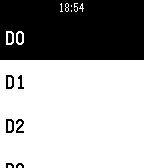

<!-- Generated by scripts/update_app_directory.py: do not edit by hand -->
[← All Pebble Developers](../developers.md)

# Mohamed Fadiga

*1 app · Last updated 2026-10-11 · [About these lists](../about-app-lists.md)*

Links: [Pebble App Store](https://apps.repebble.com/apps/dev/mohamed-fadiga_568c24b782515edae600002c)

<h2 class="app-name" id="app-56f985d469581de981000005"><a href="https://apps.repebble.com/56f985d469581de981000005">Tinker</a> v1.0</h2>
<a class="app-source" href="https://www.hackster.io/Momy93/control-your-particle-photon-from-a-pebble-smartwatch-03d1c4" title="Source code" data-search-exclude>View source</a>

App

Released 2016-03-28 Updated 2016-03-28

Runs on: Time 2, Pebble 2 Duo, Pebble 2, Time, Classic

Control your Particle Photon from your Pebble smartwatch. You can read and write all the digital and analog pins, directly on your wrist.

