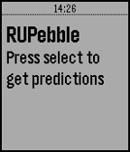

<!-- Generated by scripts/update_app_directory.py: do not edit by hand -->
[← All Pebble Developers](../developers.md)

# Mohammad Nadeem

*1 app · Last updated 2026-10-11 · [About these lists](../about-app-lists.md)*

Links: [Rebble App Store](https://apps.rebble.io/en_US/developer/595eb39bb67f9f43f80019a4/1) · [GitHub (mnadev)](https://github.com/mnadev)

<h2 class="app-name" id="app-599dc335461a8d8fd10011ed"><a href="https://apps.rebble.io/en_US/application/599dc335461a8d8fd10011ed">RU Bus</a> v1.0</h2>
<a class="app-source" href="https://github.com/mnadev/RUBus" title="Source code" data-search-exclude>View source</a>

App

Released 2017-08-23 Updated 2017-08-23 Rebble App Store

Runs on: Round 2, Time 2, Pebble 2 Duo, Pebble 2, Time Round, Time, Classic

A Pebble Watch App that lets you see Rutgers Bus Times on your Pebble.

