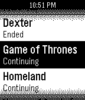

<!-- Generated by scripts/update_app_directory.py: do not edit by hand -->
[← All Pebble Developers](../developers.md)

# mongo527

*1 app · Last updated 2026-10-12 · [About these lists](../about-app-lists.md)*

Links: [Pebble App Store](https://apps.repebble.com/apps/dev/mongo527_52f00a513be620b3a4000018) · [GitHub (mongo527)](https://github.com/mongo527)

<h2 class="app-name" id="app-5355e775c822ffafd0000096"><a href="https://apps.repebble.com/5355e775c822ffafd0000096">SickPebble</a> v1.1.3</h2>
<a class="app-source" href="https://github.com/mongo527/SickPebble" title="Source code" data-search-exclude>View source</a>

App

Released 2014-04-22 Updated 2014-05-10

Runs on: Time 2, Pebble 2 Duo, Pebble 2, Time, Classic

Control SickBeard from your Pebble! Features: - Configurable to your liking - View Shows in SickBeard (With Status) - View Upcoming/Future Shows (With Time, Day, Date) - View History (Downloaded…

