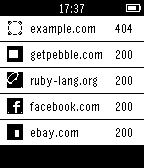

<!-- Generated by scripts/update_app_directory.py: do not edit by hand -->
[← All Pebble Developers](../developers.md)

# Moonbeam

*1 app · Last updated 2026-10-12 · [About these lists](../about-app-lists.md)*

Links: [Pebble App Store](https://apps.repebble.com/apps/dev/moonbeam_558e02ede3975e0e10000033) · [GitHub (tbloncar)](https://github.com/tbloncar)

<h2 class="app-name" id="app-5596039d49b3c859510000cd"><a href="https://apps.repebble.com/5596039d49b3c859510000cd">SiteStatus</a> v1.4</h2>
<a class="app-source" href="https://github.com/tbloncar/pebble-sitestatus" title="Source code" data-search-exclude>View source</a>

App

Released 2015-07-03 Updated 2015-09-16

Runs on: Time 2, Pebble 2 Duo, Pebble 2, Time, Classic

Monitor the status of your websites from your Pebble device. SiteStatus displays a configurable list of sites, each with a green (up) / red (down) status and HTTP status codes returned from the…

