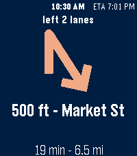

<!-- Generated by scripts/update_app_directory.py: do not edit by hand -->
[← All Pebble Developers](../developers.md)

# Moondawg

*1 app · Last updated 2026-10-12 · [About these lists](../about-app-lists.md)*

Links: [Pebble App Store](https://apps.repebble.com/apps/dev/moondawg_5fb06bdfb0b9e000539df15c) · [GitLab (Ryan-Mooney)](https://gitlab.com/Ryan-Mooney) · [Website (ryan-mooney.com)](https://ryan-mooney.com/pebble-nav-hud)

<h2 class="app-name" id="app-6a74fe5c49abe2000a25c7f0"><a href="https://apps.repebble.com/6a74fe5c49abe2000a25c7f0">Pebble Nav HUD</a> v1.12.0</h2>
<a class="app-source" href="https://gitlab.com/Ryan-Mooney/pebble-hud-navigation" title="Source code" data-search-exclude>View source</a>

App · <a href="https://forum.rebble.io/t/1217" title="Discuss this app on the Rebble forum" data-search-exclude>Forum thread</a>

Released 2026-08-06 Updated 2026-10-07

Runs on: Round 2, Time 2, Pebble 2 Duo, Pebble 2, Time

Google Maps turn-by-turn directions, on your wrist. REQUIRES a free companion app for Android: https://ryan-mooney.com/pebble-nav-hud Android only. There is no iOS version, because iOS does not…

