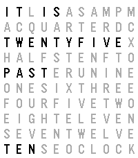

<!-- Generated by scripts/update_app_directory.py: do not edit by hand -->
[← All Pebble Developers](../developers.md)

# Moritz Mair

*1 watchface · Last updated 2026-10-11 · [About these lists](../about-app-lists.md)*

Links: [Rebble App Store](https://apps.rebble.io/en_US/developer/6ab370f843575a0009d93842/1) · [GitHub (moritzmair)](https://github.com/moritzmair) · [Website (moritzmair.de)](https://www.moritzmair.de)

<h2 class="app-name" id="app-6ab377e4cf733a0009d76732"><a href="https://apps.rebble.io/en_US/application/6ab377e4cf733a0009d76732">Wortuhr</a> v1.0.0</h2>
<a class="app-source" href="https://github.com/moritzmair/wortuhr" title="Source code" data-search-exclude>View source</a>

Watchface · <a href="https://forum.rebble.io/t/1375" title="Discuss this app on the Rebble forum" data-search-exclude>Forum thread</a>

Released 2026-09-23 Updated 2026-09-23 Rebble App Store

Runs on: Time 2, Pebble 2 Duo, Pebble 2, Time, Classic

The time in words – a QLOCKTWO-style word clock in English or German. A word clock in the style of QLOCKTWO, in English or German. Instead of digits, the watchface lights up the words in a letter…

